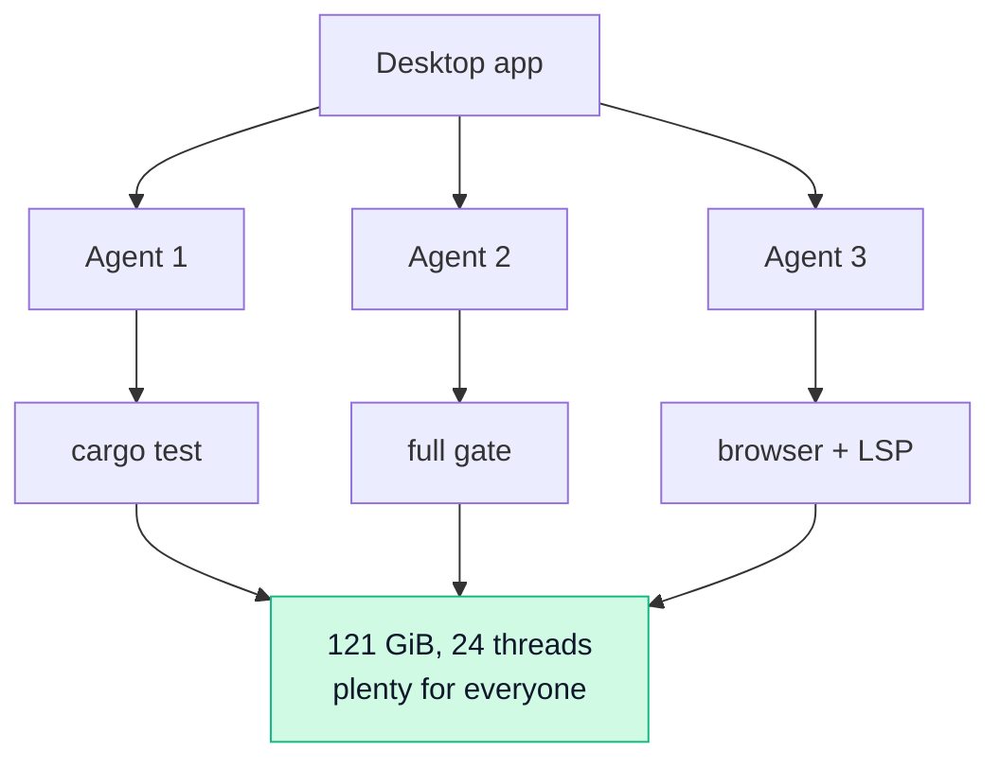
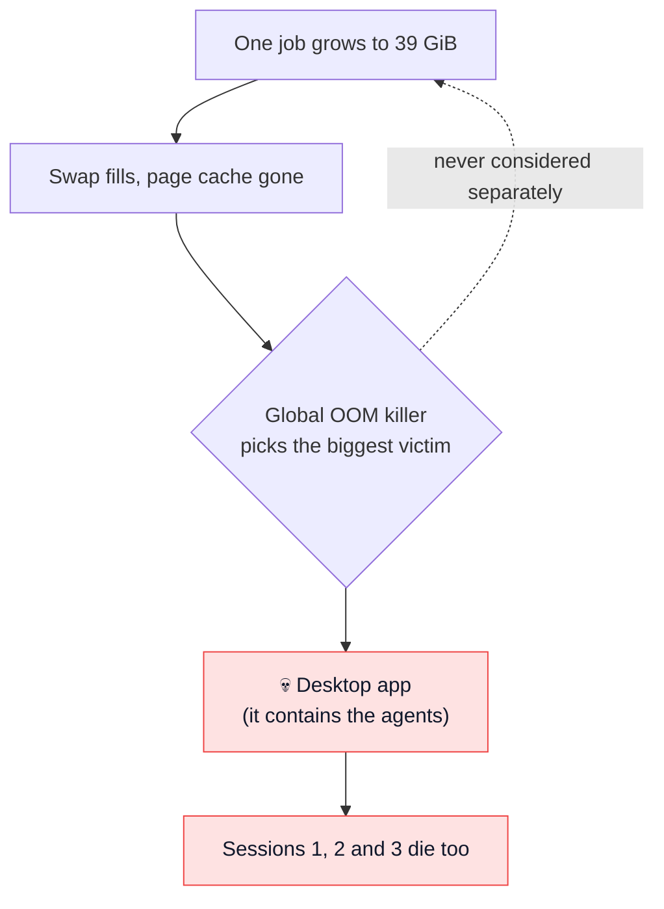
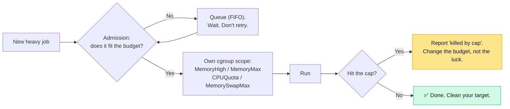

# Mad Max: Fury Load

> **What everyone "knows":** *I bought the big machine — 128 GB of RAM, 24 threads. I can run as
> many coding agents as I like, and if one of them goes wild, the OS will sort it out.*
>
> **What actually happens:** the OS sorts it out. It picks a victim, and the victim is the desktop
> app with every agent session inside it. The job that caused the problem gets to try again.
> More RAM doesn't buy you a safer machine — it buys you a bigger blast radius.

*A standalone infra war-story from the series, for anyone who just discovered that "run a few
agents in parallel" is a scheduling problem. Title is a pun on* Mad Max: Fury Road *— a convoy
rationing scarce supplies under one very controlling warlord turned out to be exactly the right
picture. Also the load averages hit 400, so: Fury Load.*

---

## The belief: a big machine is a safe machine

The setup is sensible. You have real hardware — 128 GB nominal, 121 GiB the kernel will admit to,
24 threads, a couple of fast SSDs. You open the desktop app, start three or four agent sessions,
and let them work. Builds, test suites, a browser, a local VM.



And steelman it, because this is not a dumb belief. Linux *does* have an OOM killer. cgroups *do*
exist. The scheduler is genuinely good at sharing 24 threads. 121 GiB is more memory than entire
production clusters I've run on purpose. Four agents, each doing roughly what one developer would
do, ought to fit with room to spare.

It fits right up until one of them doesn't.

---

## Trap 1: the kernel kills the wrong thing

One process — a conformance run, started by one agent, inside the desktop app's cgroup — grew to
**39 GiB.** Swap filled. Page cache evaporated. The kernel's global OOM killer woke up, scanned
for a victim, and chose the process with the biggest footprint.

That was the desktop app. Which *contained* every agent session. All of them died, including the
three that had done nothing wrong.



Read that diagram again, because the arrow that matters is the dotted one. The runaway job was
never a candidate. It was a *child inside* the fat process, so its memory counted toward the
parent's score, and the parent is what got shot. The culprit's bill was paid by its host.

The instinct here is "I need more RAM." That instinct is wrong, and expensively so. The same job
would have taken down a 256 GiB box — you'd just have been running six agents on it instead of
three when it happened.

> 🤓 *Nerds, this part's for you:* the global OOM killer scores by `oom_score_adj`-weighted RSS of
> a *process*, and nothing in that calculation knows which subtree misbehaved. Put the job in its
> own cgroup and you get a different killer: the **cgroup** OOM, which can only kill inside that
> cgroup. `MemoryMax` is the hard wall it enforces; `MemoryHigh` sits below it and applies reclaim
> *throttling* first, so a job that drifts over gets slowed down and usually finishes, instead of
> being shot. Afterwards, `memory.events` in the scope's cgroup carries an `oom_kill` counter —
> which is how you tell "my cap was too small" apart from "the host was out of memory," a
> distinction the exit code alone will never give you.

---

## Trap 2: three resources, three completely different deaths

You cannot watch this with one number, because the three things that run out don't fail the same
way.

| Resource | How it fails | What you see first |
|---|---|---|
| **Memory** | A cliff. Swap fills, cache disappears, kernel shoots someone. | Nothing, then everything is gone. |
| **CPU** | Latency, not failure. | Load average 50–400. Nothing crashes; the desktop just stops responding. |
| **I/O & disk** | Slowly, then all at once. | Builds "feel sluggish" for a week, then a full volume eats a session. |

The CPU row is the one people misread. Load averages in the hundreds don't crash anything —
that's the problem. There's no event, no log line, no exit code. The machine is simply unusable
for an hour and then fine again, which is indistinguishable from "my laptop is getting old."

And the disk row is the one that bites agents specifically: **one target directory per worktree**
is not a tidiness rule, it's a correctness rule. Two agents sharing a build target will corrupt
each other's incremental state and blame the compiler.

---

## Trap 3: the first knob you'd reach for makes it worse

Here's the counterintuitive one. Faced with an anonymous-memory-heavy box that just OOM'd, the
reflex is to make swap *less* likely — drop `vm.swappiness` from 60 to 10, because 10 sounds
disciplined and 60 sounds like thrashing.

On this workload that gets you OOM-killed **sooner.** Swappiness is a bias between reclaiming page
cache and reclaiming anonymous pages. A box running builds and agents has very little page cache
and a great deal of anonymous memory, so telling the kernel "prefer to drop cache" means telling
it to prefer reclaiming a thing that barely exists. There's nothing left to give, so it skips
ahead to the part where it kills something. Keep it around 60.

The matching misread: **a full swap file is not an emergency.** Cold pages parked on NVMe is swap
doing its job. The number that tells you whether you're in trouble is pressure, not percentage:

```bash
cat /proc/pressure/memory   # "some avg10" climbing = real stall, act now
free -h; swapon --show      # context, not a verdict
systemd-cgtop -m            # which scope is actually eating
```

Same shape, one layer up: `-j$(nproc)` is the correct setting for one build on one machine, and
wrong for every agent after the first. Four agents each asking for 24 compile jobs is 96 jobs on
24 threads — a machine that is busy doing almost nothing.

---

## The model, drawn honestly: a bouncer, not a bigger room

The fix isn't tuning. It's **governance** — deliberately trading peak throughput for predictable
completion. Six moving parts, and the first one does most of the work:



On Linux that's `systemd-run --user --scope` plus `flock` tickets for the slots — a wrapper script,
not a platform. On Windows the same design lands on Job Objects (`JOB_OBJECT_LIMIT_JOB_MEMORY`,
CPU rate control), which contain the whole child tree. macOS is the weak one: `setrlimit` is
per-process, so you monitor RSS and kill the process group yourself.

Reserve the machine before you divide it:

| Slice | 121 GiB desktop |
|---|---|
| OS, desktop, browsers, LSPs | ~30 GiB |
| Local VM | 24 GiB |
| Heavy agent jobs | 48 GiB |
| Headroom | ~19 GiB |

Then spend the agent slice in fixed shapes, so "how many can I run" has an arithmetic answer
instead of an optimistic one:

| Profile | `MemoryHigh` | `MemoryMax` | CPU | Swap max |
|---|---:|---:|---:|---:|
| normal | 14 GiB | 16 GiB | 400% | 2 GiB |
| large | 28 GiB | 32 GiB | 600% | 2 GiB |

Two normal, or one large plus one normal — 48 GiB worst case either way. FIFO, no preemption:
killing a 30-minute gate to admit a 2-minute test wastes more than it saves. And a large job takes
one slot, not the whole machine; it is not a stop-the-world event.

Scale it by RAM and nothing about the mechanism changes:

| RAM | Heavy budget | Max concurrency | Swap |
|---:|---:|---|---:|
| 32 GiB | 16 GiB | 1 heavy **or** 2 normal | 8–16 GiB / zram |
| 64 GiB | 32 GiB | 2 normal **or** 1 large | 16 GiB |
| 128 GiB | 48 GiB | 2 normal **or** 1 large + 1 normal | 16–32 GiB |

On a 32 GB laptop the margins are thin enough that the cap *is* the safety net and swap is only
the cushion. Close the browser tabs before a full gate; they are real memory. And prefer one agent
doing a focused task over five agents doing "just a quick check" — five quick checks is how you
discover that your 16 GiB agent slice was an aspiration.

---

## Yes, but — you're paying for 121 GiB and deliberately using 69 of it

Fair hit. The budget above hands 48 GiB to agents and parks 19 GiB as headroom, and on a quiet
afternoon you can watch a two-thirds-asleep machine make your job wait in a queue. That is a real
cost, and "just buy more RAM" is a real answer — for a while.

It stops being about the number, though. Headroom is not idle memory; it's page cache, and page
cache is the entire reason your second build is faster than your first. Spend it and nothing
crashes — every warm read quietly becomes a disk read, and you own a slower machine with an
unchanged spec sheet. Meanwhile the failure you were actually worried about doesn't scale with
capacity at all: 39 GiB took down a 121 GiB box because nothing bounded it, and on a 256 GiB box
you'd simply have had more sessions open when it went.

Capacity moves the cliff further away. It never builds a fence. Keep the headroom — the part of
the machine you can't see working is what keeps the rest of it fast.

---

## The takeaways

1. **Contain, don't capacity-plan.** A cap is a fence; RAM is just a bigger field to run across.
   Every heavy job gets its own cgroup scope or Job Object, so the kernel kills *the job* instead
   of whatever large process happens to be holding your sessions.
2. **The OOM killer optimises for the wrong thing.** It picks the biggest victim, not the guilty
   one — and if your agents live inside an app, the app is the biggest victim. Nothing about that
   improves when you add memory.
3. **Three resources, three alarms.** Memory fails as a cliff, CPU as latency you'll blame on your
   hardware, disk as a slow slide into a wall. Watch `/proc/pressure/*`, not swap percentage.
4. **Bound every multiplier before it multiplies.** `-j$(nproc)`, unbounded `--test-threads`, and
   a shared build target are all fine for one job on one machine, and all wrong the moment a
   second agent exists. Pin them; one target per worktree.
5. **Headroom is load-bearing.** A queue that makes a job wait ten minutes beats a machine that
   swaps for thirty and then takes every session with it. Predictable throughput is the goal;
   maximum parallelism is the thing that looked like the goal.

"Witness me" is a tremendous line in a film and a terrible one in a terminal. Cap the job, take a
ticket, and let the convoy arrive intact.

---

*Part of the series · Back to the [index](README.md).*
