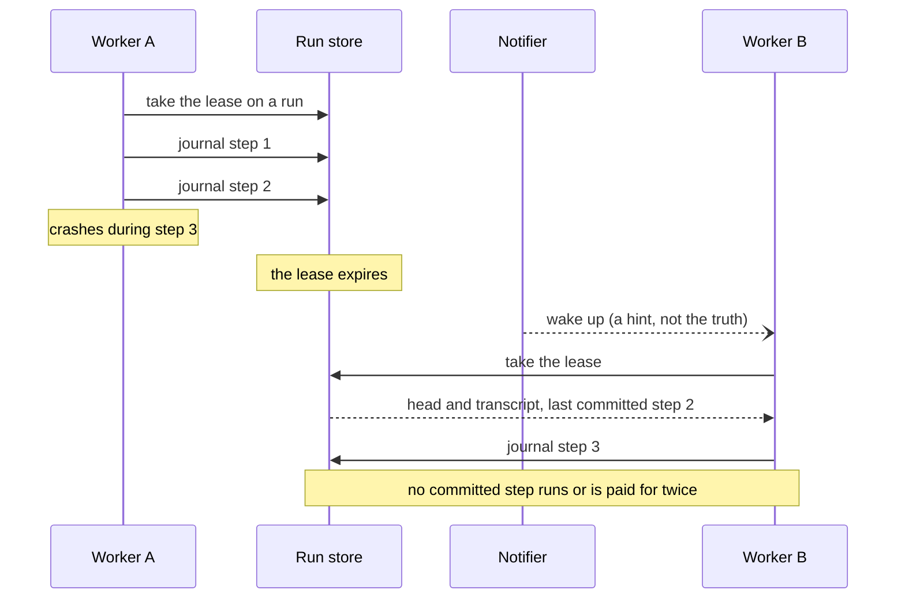
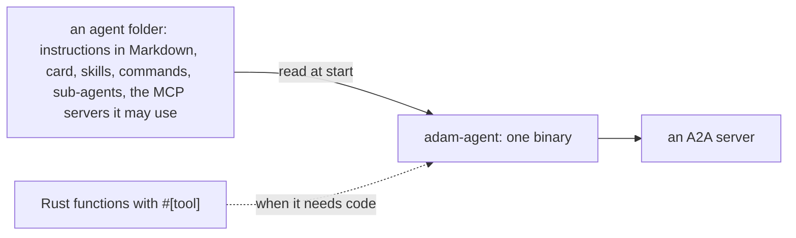
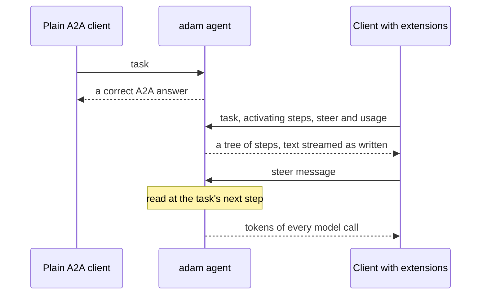
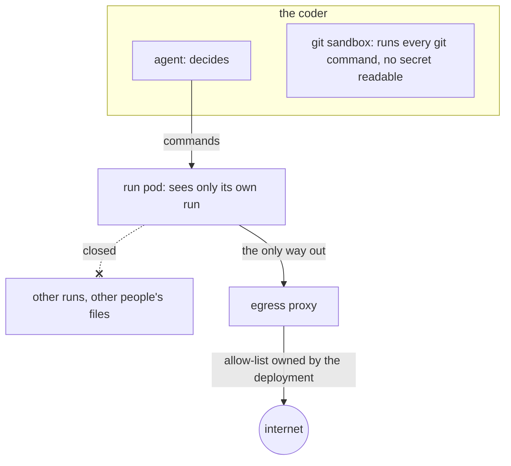
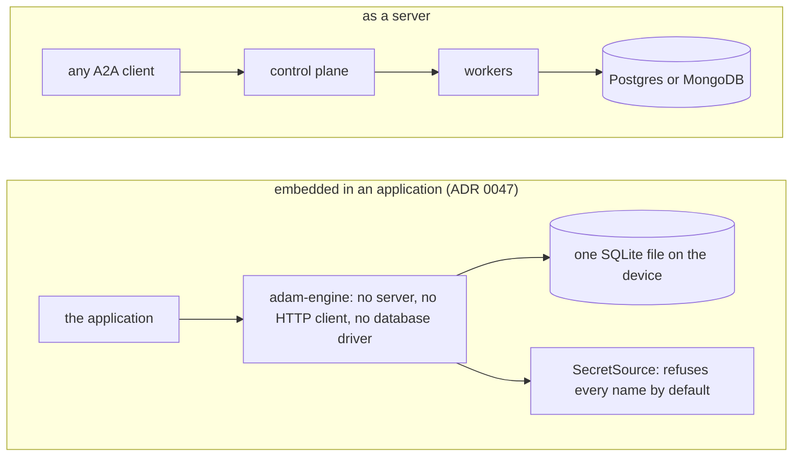
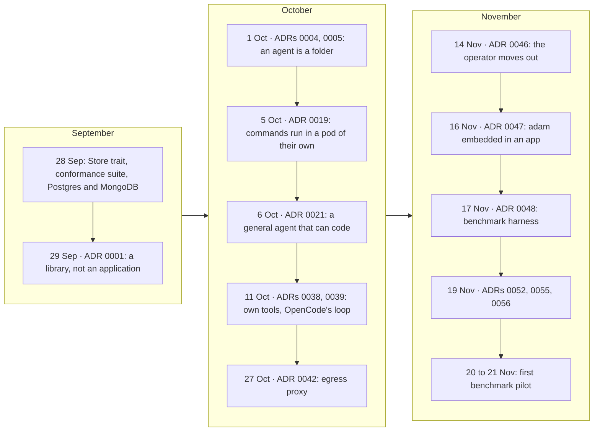

# Building adam-rs, part 1

In eight weeks, adam-rs went from an empty repository to a Rust framework for durable AI agents: 34 crates, 504 commits and 60 decision records, between 28 September and 21 November 2026.

adam-rs answers one question: what does an AI agent need so it can run for hours, survive a crash, and be trusted with real work? Its answer is a durable agent loop over a run store, agents written as folders of Markdown and Rust functions, and an A2A server in front, so any client can talk to them. Two agents ship with it: **adam-coder**, which takes a coding task to a verified pull request, and **adam-agent**, which serves any agent folder.

This first article tells how it was built, decision by decision. A second article will cover what comes next.

## Where it started: state first

The first commit, on 28 September, was not an agent. It was a `Store` trait, a conformance suite for it, and two adapters, Postgres and MongoDB. Everything else was built on top of durable state.

The next day, ADR 0001 set the shape of the project. adam-rs is a **library** that a host program embeds, not an application. A host runs a control plane and workers, and the roles `control-plane`, `worker` and `all` are a closed enum in adam-rs, the same for every host.

Three ideas from those first days still carry the framework:

- **Infrastructure is a trait with a testkit.** The store, the notifier, the model client, the code host: each is a Rust trait, and each has a conformance suite that every implementation must pass. A new backend proves itself against the same tests as the old ones.
- **A run is journaled.** Each step of an agent run is written to the store before it counts. A worker that crashes leaves a run that another worker picks up from its last committed step, and a step is never paid for twice.
- **Work is leased.** A worker holds a lease on the run it is executing. When the lease expires, the run is free for another worker. A notification may wake a worker sooner, but the store decides; a signal is never the truth.

On 19 November, ADR 0055 refined the journal: a run's state is a small head plus an append-only transcript. A run that lasts hours stays cheap to resume.

## An agent is a folder

On 1 October, ADRs 0004 and 0005 decided how agents are written. An agent is a **folder**: its instructions in Markdown, its card, its skills, its commands, its sub-agents and the MCP servers it may use. One binary, `adam-agent`, serves any such folder, read at start. Writing an agent needs no Rust and no build.

When an agent needs code of its own, a Rust function becomes a tool with one attribute, `#[tool]`. Its arguments become the tool's schema, checked at compile time.

The coder came next. On 6 October, ADR 0021 settled what it is: **adam is a general agent that can code**, not a separate kind of agent. On 11 October, two decisions followed:

- **ADR 0038: the coder drops OpenCode.** Until then, adam drove OpenCode to edit code. From that day the coder edits code with its own tools.
- **ADR 0039: the agent loop takes OpenCode's structure.** What made OpenCode good, its loop, was studied and adopted, and agents gained plugins.

OpenCode stayed in the project in one role only: the baseline the benchmark measures adam against.

## Speaking A2A

Every adam agent is an A2A 1.0 server. A client that speaks plain A2A can send it a task and read the answer. A client that knows more can switch on **extensions**, announced on the agent's card and activated per request:

- **Steps and streamed text** (ADR 0007): the work shows as a tree of steps, each tool call with its input and output (ADR 0011), and the answer streams as it is written.
- **Steer** (ADR 0016): a message sent to a working task is read by that task, at its next step.
- **Usage** (ADR 0032): the tokens of every model call, and later the time a run's commands used in a pod (ADR 0043).
- **Access tiers** (ADR 0036): the person picks how much the agent may do on its own, and the coder keeps to it.
- **Child sessions** (ADR 0045): a sub-agent can run in the background, as a session the client can follow.
- **A2UI**: the agent draws forms and cards the client renders, from a catalog the client declares.

The rule for all of them comes from ADR 0006: an extension is optional. A client that ignores it still gets a correct A2A answer.

A2UI had the most dramatic change. On 19 November, ADR 0056 chose a **hard cutover** to A2UI v1.0: no dual support, old surfaces shown read-only as made by an earlier version. The cutover was finished across every repository two days later.

## Running code safely for many people

A coder runs commands, and commands are the dangerous part. Five decisions built the walls around them, one at a time:

1. **A run's processes live in a pod of their own** (ADR 0019, 5 October). The agent decides; a separate run pod executes.
2. **A run pod sees only its own run** (ADR 0041). No other person's files, no other run's workspace.
3. **Run pods reach the internet only through an egress proxy** (ADR 0042, 27 October), with an allow-list the deployment owns. The network is closed by default.
4. **The coder's own git runs where no secret is readable.** A git sandbox beside the coder runs every git command, so a repository's hooks or filters can never read a token.
5. **No Podman** (ADR 0052, 19 November). A repository's own environment is a run pod made from its image, not a container started inside another one.

The Kubernetes operator that runs all of this started inside adam-rs (ADR 0029). On 14 November it moved to the platform repository (ADR 0046), and adam-rs went back to being a library and its two agents.

Every wall is fail-closed. No bearer token, no server. An MCP server kind is allowed by the deployment, never by an agent's own files. A secret never lands in a file or a log.

## Embedding adam in an application

Until mid-November, adam ran as a server. On 16 November, ADR 0047 decided that adam can also be **embedded in an application**, as a library with no server at all. That needed a new crate, `adam-engine`, and a strict diet:

- **No server, no HTTP client, no database driver and no Kubernetes client** in the engine's dependency tree. A CI job fails if one creeps in.
- **A `SecretSource` that refuses every name by default.** The application decides what the agent may read.
- **One SQLite store** (ADR 0053). A run lives in a file on the device, and only one process may hold that file.
- **Kill and resume.** A process killed in the middle of a run is replaced by the next one, which finishes the run without repeating a committed step.

The durable primitives came with it, all built the same week:

- **Schedules are parked runs** (ADR 0060): a run that waits for a time is just a run that is not due yet.
- **A step names its retry policy** (ADR 0061).
- **A race of steps records its winner** (ADR 0062), so a replay picks the same one.

The engine also learned what the server agents could already do: run a folder's commands, take the host's own tools, read the files a run hands over, list and stop its scheduled runs, and start child sessions.

## Measuring it against OpenCode

The goal for adam is plain: as good as OpenCode, or better. On 17 November, ADR 0048 added a benchmark harness that runs both on the same tasks, with the same model, and has a blind reviewer score each change.

The first pilot ran on 20 and 21 November: 5 tasks, 4 variants, 2 reasoning levels, 40 runs, one model. A pilot shows patterns, not a ranking.

| What was measured | adam | OpenCode |
| --- | --- | --- |
| Review score of a solved task (out of 5) | 4.5 to 5.0 | 3.4 to 4.0 |
| Size of each model request | about 94 KB | about 25 KB |
| Cost per run, relative | about 4× | 1× |
| Time per run at `low` reasoning | about 12 min | about 3 min |

```mermaid
---
config:
  xyChart:
    height: 340
---
xychart-beta
    title "adam ÷ OpenCode: a better change, at about four times the cost"
    x-axis ["Review score (range midpoints)", "Request size", "Cost per run", "Time per run (low reasoning)"]
    y-axis "times OpenCode (line = OpenCode)" 0 --> 4.5
    bar [0, 3.8, 4, 4]
    bar [1.3, 0, 0, 0]
    line [1, 1, 1, 1]
```

Three findings shaped the next work:

- **adam writes the better change.** The gap is mostly tests: adam adds them, OpenCode mostly does not.
- **adam pays for what it sends, not for what it does.** A lean variant with only the 13 coding tools cost about the same as OpenCode, with the same review scores.
- **Every adam failure had one cause.** With reasoning on, the model sometimes spent its whole output budget thinking and returned nothing. A fix that continues such a turn merged the same day.

The pilot also showed that the highest reasoning level was not worth it: it cost one and a half to three times as much and solved no task that the low level missed.

## How it was built

adam-rs was built at a pace a small team rarely sustains: 77 commits in its first three days, at the end of September, 158 in October, 269 in the first three weeks of November. Four habits kept that pace from turning into chaos.

The decisions bunch up at the end: 18 of the 60 records date from the last week alone, from 16 to 21 November.

- **Every decision is a record.** 60 decision records, numbered up to 0066, each with its context, the decision and its date. A changed mind is a dated amendment, never a silent rewrite.
- **Every infrastructure seam has a conformance testkit.** The SQLite store arrived in November and passed the same 76 cases the Postgres store had passed for weeks.
- **Parity is checked, not assumed.** A matrix lists every setting and feature across the coder, the folder agent and the embedded engine. Each empty cell is an open issue.
- **Failures get a root cause.** A test that fails once is a bug to find, never a test to switch off. Two intermittent failures were traced to the tests themselves in the last week, and fixed there.

Much of the code was written by AI coding sessions working in parallel. Each session claims its paths on a shared board before it starts, posts when a pull request is green before it merges, and cleans up when its task is over. One coordinating session assigns the work and relays the owner's decisions. The owner decides; the sessions build, test and prove.

## Where it stands, and what part 2 covers

On 21 November, adam-rs is built and proven on mocks, scripted models, Kubernetes in CI and the first benchmark runs. It has not yet served people in production.

The decisions of the last days point to what comes next:

- **A lean first request** (ADR 0066). A "Hi" should not cost 22 000 tokens. Tools come in groups, each behind a small loader, so a chat agent starts under 5 000 tokens and the coder under 8 000.
- **Reasoning per model** (ADRs 0063 and 0064). No global default: each model declares the levels it takes, its wire format and its output cap, measured model by model.
- **Resource governance.** An agent on a person's own computer gets budgets for cores, memory and disk, and waits instead of failing when a budget is full.
- **adam in an application on four platforms.** The same agent behind one app on Android, iOS, desktop and the web, on networks that drop and reconnect.

Part 2 will tell how those land, and what the second benchmark says.
