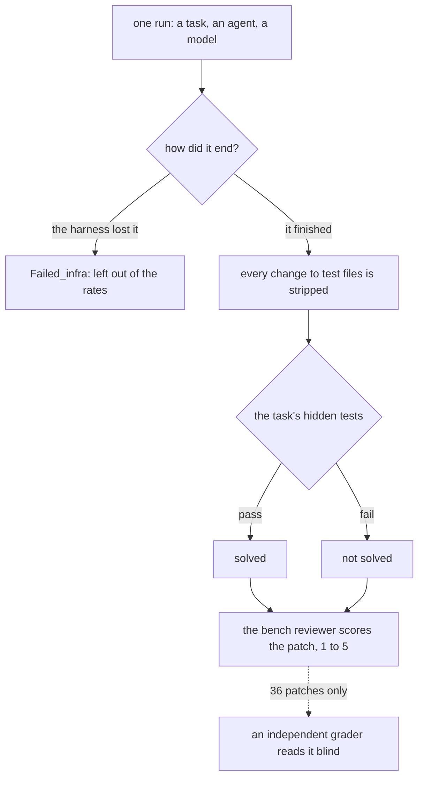
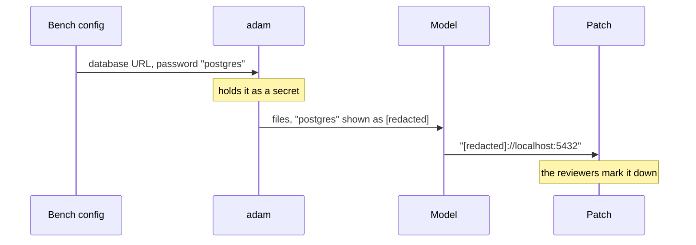

# Building adam-rs, part 2: was the benchmark any good?

The second benchmark put adam against OpenCode on three models and ten tasks. A second, sceptical reading of every output kept two of its findings and dropped several others.

[Part 1](/journal/building-adam-rs-part-1) told how adam-rs was built, and described a first pilot: 40 runs, one model, a pattern rather than a ranking. This part is the second benchmark: 75 runs over the night of 21 to 22 November 2026, and 20 more the next afternoon. It is also the review of that benchmark, which recomputed every number from the outputs without running anything, and which changed the story more than the runs did. How the other plans from the end of part 1 land is left for a later part.

In three lines:

- **It was a good pilot and a weak benchmark.** It found real behaviour and real bugs, but with one run per task it cannot say which agent solves more.
- **Two findings hold, both on DeepSeek.** adam writes tests and OpenCode almost never does. And adam costs about four and a half times as much as OpenCode on the same tasks, more on every one of them.
- **Several published readings are not supported.** Nothing shows adam-lean worse than adam, nor adam cheaper on MiniMax, and "as reliable as OpenCode" counted only the runs that finished.

## What ran

Three agents, all given the same ten task statements:

- **adam**, the coder from part 1, with its 42 tools and its full prompt.
- **adam-lean**, the same coder with 13 tools and only the work sections of its prompt.
- **OpenCode 2.3.0**, with its built-in prompt, as the baseline.

Three models: DeepSeek V4.1 and MiniMax M3 at low reasoning, Gemini 3.1 Flash-Lite at medium. Ten tasks: eight from real open-source projects, in TypeScript, Python, JavaScript and Go, and two small ones of the bench's own. Each run had 50 minutes, 200 steps and an output cap of 32,768 tokens. MiniMax stopped after five tasks, when it reached its $8 budget.

Each task ran **once** per agent and model. That single fact decides most of what follows.

A run becomes a result in two ways, and they measure different things:

The hidden tests decide "solved". The tests an agent wrote are stripped first, so a pass says nothing about them. The reviewers read the whole patch, tests included.

## The pass rate hit the ceiling

On DeepSeek, 26 of the 26 runs that finished passed. On MiniMax, 11 of 11. When every agent solves everything, the pass rate carries no information about the agents.

Small samples make it worse. Nine passes out of nine still leave a 95% interval that reaches down to 70%; three out of three reach down to 44%. The image above draws those intervals: on DeepSeek and MiniMax the three agents are indistinguishable.

Only Gemini Flash-Lite, the weakest of the three models, put tasks in the range where agents differ. There adam solved 6 of 10, adam-lean 5 and OpenCode 4. adam solved three tasks OpenCode missed, and OpenCode one that adam missed. A paired test on those four tasks gives p = 0.625: noise. And the Gemini comparison spans two sessions: OpenCode's runs are from the night, adam's and adam-lean's from the next afternoon, on a newer coder and harness version. Provider load, cache state and the coder changes are all mixed into the difference.

Run-to-run noise is large too. Five DeepSeek tasks ran in both the pilot and the night. The same agent on the same task moved by a factor of 1.4 to 1.6 in cost. OpenCode, whose version did not change, still moved by about 1.4×; adam's spread, which also includes a version change, reached 1.6×, as when one task cost it $0.445 in the pilot and $0.279 the next night. Any single-run difference smaller than about 1.6× is noise.

## Finding one: adam writes tests, when the model does

Patches that add or change a test file, read from the diffs (DS DeepSeek, MM MiniMax, Gem Gemini, OC OpenCode):

```mermaid
---
config:
  xyChart:
    height: 340
---
xychart-beta
    title "Patches that touch a test file, % (accent: OpenCode on DeepSeek)"
    x-axis ["DS adam", "DS lean", "DS OC", "MM adam", "MM lean", "MM OC", "Gem adam", "Gem lean", "Gem OC"]
    y-axis "% of patches" 0 --> 100
    bar [100, 100, 0, 67, 50, 50, 30, 20, 20]
    bar [0, 0, 11, 0, 0, 0, 0, 0, 0]
```

On DeepSeek, adam and adam-lean touched tests in all 17 of their patches; OpenCode in 1 of 9. adam's patches added a median of 55 test lines; OpenCode's a median of zero.

Both reviewers score adam's DeepSeek patches higher. The independent grader put adam ahead on 7 tasks out of 7, by 0.97 point on a five-point scale. Take the tests criterion out and the gap shrinks to 0.29. **The quality gap is almost all tests.**

On Gemini the habit fades, for every agent: each wrote tests in two or three patches out of ten. So this is not adam losing something; it is the model. Gemini Flash-Lite writes little and stops soon: adam's Gemini runs emit a median of 108 output tokens per call, against 598 on DeepSeek. adam's prompt asks it to find the project's checks, run them, and open a pull request when they are green; an earlier reading of the prompt found no line asking for a new test. DeepSeek appears to read "verify" as "write a test and run it"; Flash-Lite as "run what is there", or not at all. Without transcripts, that reading stays an inference.

The hidden tests are a loose proxy in the other direction too. Of the 48 passing patches the bench reviewer scored, 13 got a correctness score below 4. One Gemini OpenCode patch passed while printing every configuration value to the error output and adding a stray file. One Gemini adam patch passed after removing an import still in use and editing an existing test. Neither would be merged.

## Finding two: on DeepSeek, adam costs more on every shared task

On DeepSeek, OpenCode was cheaper on every task both agents finished: seven out of seven against adam, nine out of nine against adam-lean.

Each point is the geometric mean of the per-task cost ratio, with its interval. On DeepSeek and Gemini the intervals sit well to the right of 1×, though on Gemini adam was cheaper on one task of ten. MiniMax goes the other way: adam's interval runs out to both sides of 1×, and adam-lean was cheaper than OpenCode on all four of its tasks (0.55×), largely because OpenCode's MiniMax runs were long. Three and four tasks are too few to lean on.

The totals per run suggest where the money goes on DeepSeek, even without transcripts:

- **More calls.** adam makes 2.7 times OpenCode's calls on the same task, and adam-lean 2.2 times.
- **Many small steps.** A rough two-parameter fit over about 19 runs per agent puts adam's effective first request near 38,000 tokens and OpenCode's near 10,000, but adam's context grows by only 329 tokens per call, against 1,156 for OpenCode. adam appears to start heavy and add little each time.
- **More thinking per call.** adam writes 598 output tokens per call against OpenCode's 364, and 74% of adam's output is reasoning (55% for OpenCode).
- **Probably the tests themselves.** Running a suite and fixing what breaks costs calls; how much of the gap that explains is not measured.

Long loops are not adam's alone. The longest run of the night series is OpenCode on MiniMax: 196 calls and $0.92 for a 16-line change. But on DeepSeek, adam took 112 calls for a two-file fix that OpenCode made in 15.

This also corrects part 1. The pilot suggested that the lean variant cost about the same as OpenCode. In the night series, on DeepSeek, it cost 2.72 times as much. The pilot ran with a smaller output cap and different coder versions, so the two cannot be pooled, but the pilot's reading did not carry over.

### What the lean first request would save

One of the plans at the end of part 1 was ADR 0066, the lean first request. The night's totals allow an estimate. Assume adam's per-call prompt drops from the 94 KB measured in the pilot to adam-lean's 31 KB, and that calls and output stay as they are:

```mermaid
---
config:
  xyChart:
    height: 340
---
xychart-beta
    title "Median DeepSeek run, $ (accent: lean first request)"
    x-axis ["adam today", "adam, lean request", "adam-lean, measured", "OpenCode"]
    y-axis "US dollars" 0 --> 0.07
    bar [0.059, 0, 0.048, 0.016]
    bar [0, 0.048, 0, 0]
```

The median adam run falls from $0.059 to $0.048 on DeepSeek, 19% less; by 22% on Gemini, and by 29% on MiniMax, where cached input is dearest, though that rests on three runs. adam-lean's measured DeepSeek median lands exactly on the projection. Still, that is about three times OpenCode's $0.016. The lean prompt removes a fifth of the cost; most of the rest is likely the number of calls and the output in each.

## What did not hold up

The first write-up of the night drew conclusions the outputs do not carry:

- **"adam-lean is below adam in quality."** That compared averages over different tasks. Paired on the same tasks, the difference on DeepSeek is zero for both reviewers. The gap came from which tasks each happened to finish.
- **"adam is cheaper on MiniMax."** Three tasks, with an interval from 0.23 to 2.89 times OpenCode.
- **"adam is as reliable as OpenCode."** The rates counted finished runs only. Counted by delivered patches, DeepSeek is 80% for adam against 90% for OpenCode, MiniMax 60% against 80%. Both gaps are within noise: the data supports neither "as reliable" nor "less reliable".
- **"adam's test habit does not carry over to Gemini."** No agent's did.
- **"The harness fix covers 10 of 75 runs."** That count cannot be reproduced from the outputs, which show 8 harness failures in 45 runs, plus 20 Gemini runs of adam and adam-lean lost to a coder bug with Gemini's thought signatures.

## What the bench found wrong with adam

**The scrubber rewrote code.** adam replaces the values of the secrets it holds with `[redacted]` before the model sees them, down to values four characters long. The bench database's password, part of the URL adam is given, was the word `postgres`. In one task the word is also a protocol name, so adam's patches came back with it scrubbed:

One patch wrote `[redacted]://localhost:5432`; another wrote `[redacted]` nine times, in protocol names and documentation links. No adam-lean or OpenCode patch did. Any deployment whose secret is a common word is exposed the same way.

**Runs ended with nothing.** The harness lost 8 runs out of 45 on DeepSeek and MiniMax. Five of them were on one large task, which hit every agent on MiniMax and two of the three on DeepSeek. The other three were all adam's. If losses fell evenly across the agents, all three landing on adam has a chance of 1 in 27: suggestive, not proof, since adam's runs are longer and more exposed to a failed last call. In all, adam lost four runs on DeepSeek and MiniMax, and three of them spent $1.33 between them and left no patch. A lost run costs more than any quality gap measured here.

There is also money nobody can explain. Pricing each run's token counts reproduces OpenCode's cost to the cent on DeepSeek and Gemini, but leaves 16% of adam's DeepSeek spend unaccounted for. Calls aborted before any usage was reported, which the meter charges at a worst case, are a plausible source, not a proven one.

## Who checks the reviewers

Two reviewers scored the patches: the bench's own, DeepSeek V4.1 taking the median of three samples, and an independent Claude grader that read 36 patches blind. They agree well on ranking (a rank correlation of 0.80 over the 33 patches both scored), and the DeepSeek reviewer is the harsher, by 0.4 to 0.8 point.

Three caveats stay open:

- On the DeepSeek series, the reviewer is the same model that wrote the patches.
- Both rubrics count tests as a full criterion, and tests decide the ranking. A reader who writes tests themselves weighs that differently.
- The grader is Claude, and the second reading of the whole bench was done by a Claude session too. A shared taste for thorough, pull-request-shaped patches would favour adam in both. No reviewer from a third model family has looked yet.

## What changes in adam

The review's list, most pressing first:

1. **Never end a run with nothing.** Commit work in progress at intervals, so the harness can collect it, and record why a task ended.
2. **Stop the scrubber from rewriting code.** Raise the minimum for values that occur as words in source, or mark the replacement so the model knows it is not file content. Give the bench a random database password.
3. **Shorten the loop and the thinking, not only the prompt.** Stop at the first green run of the project's checks, budget steps by the size of the change, and catch loops that edit the same file back and forth.
4. **Ship the lean first request, measured per model.** Keep the four work sections of the prompt: they appear to be where the tests come from.
5. **Ask for the test.** One line in the prompt, "add or update a test that covers the change", is cheap and measurable next time.

## What the next bench must do

The variance in this series sets the sample sizes. To detect a difference at the usual 5% level with 80% power:

| To detect | Needs about |
| --- | --- |
| Solved 60% against 40%, separate groups | 97 runs per agent |
| Solved 50% against 40%, separate groups | 388 runs per agent |
| Same tasks, 40% of tasks split, 3 of 4 splits to one agent | 77 tasks |
| Review difference of 0.5 point, same tasks | 31 tasks |
| Cost 20% lower, same tasks | 121 tasks |
| Cost halved, same tasks | 13 tasks |

Comparing agents on the same tasks is far cheaper than comparing their rates. Beyond the numbers:

- **Tasks in the range that discriminates:** ones each model solves 30 to 70% of the time, dropping those every agent solves. DeepSeek needs harder tasks; Gemini needs most of the current ones. 40 to 80 tasks per model for a pass-rate claim.
- **Two runs per cell** on at least 20 tasks, so the noise is measured, not assumed.
- **One window, one version.** All agents in the same night, on the same coder and harness versions.
- **A reviewer from a third family**, never the model under test, with scores reported with and without the tests criterion, and a person reading a tenth of the patches blind.
- **Keep the transcript.** Per call: the tool, the bytes in and out, the reasoning tokens, the compactions. Without them, "why is the loop long" stays a guess.
- **Report delivered runs beside solved ones**, and log which rule classed each lost run as the harness's fault.

## Where it stands

On DeepSeek, adam and adam-lean write the better-reviewed patch, mostly because they write tests, at 2.7 (adam-lean) to 4.5 (adam) times OpenCode's price. That rests on one model, whose own reviewer scored its patches. Whether adam solves more, this benchmark cannot say.

The changes above come first. The bench after them should run on harder tasks, twice per cell, in a single window, and read its own results the way this one was read: as a claim to check.
